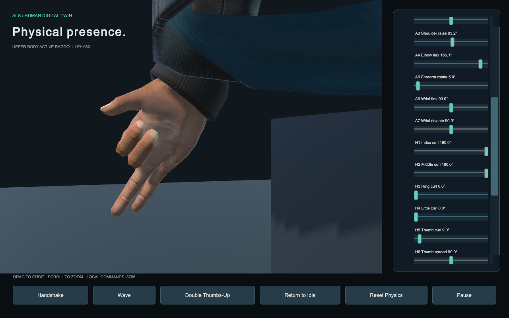

# 13 路机械手臂与虚拟人映射说明

本方案将一套“7 个手臂舵机 + 6 个手掌舵机”的输入对应到虚拟人的一侧上肢。每路输入控制一个功能；同一根手指的多个指节按联动关系生成目标，再由物理关节电机追踪。

**当前已完成软件映射、调试界面和本地输入接口；实物运动链及舵机参数仍待确认。** 本说明中的 A/H 编号均为逻辑标签，不是控制板接线号。

## 1. 已知信息与暂定设计

| 项目 | 当前依据与结论 |
|---|---|
| 数量 | 用户提供：手臂 7 个、手掌 6 个舵机；一套合计 13 路 |
| 手掌结构 | 照片可见四个长指的联动机构，以及拇指侧的附加机构 |
| 手臂分配 | 未获得手臂全图；暂用肩 3 + 肘 1 + 前臂 1 + 腕 2 |
| 手掌分配 | 暂用四指各 1 路，拇指弯曲与外展/对掌各 1 路 |
| 左右侧 | 虚拟人两侧均支持；照片中的实物要对应哪一侧需确认 |
| 实物参数 | ID、轴方向、行程、零位、传动关系及通信协议未测定 |

若实物第七轴的位置不同、四指并非独立，或拇指第二路不控制外展，需要按真实机构修改映射，不能仅更换端口编号。

## 2. 13 路功能对应表

`values` 数组严格按下表 0–12 顺序排列。默认输入为 0–180°的**虚拟舵机角度模板**；表中的目标范围是工程的相对姿态参数，不是已测得的实物范围或临床关节活动度。

### 手臂 7 路

| 数组下标 | 逻辑号 | 暂定功能 | 虚拟骨骼及轴 | 当前目标范围 |
|---:|---|---|---|---|
| 0 | A1 | 肩前抬 / 后摆 | `R/L_UpperArm` X | −105…65° |
| 1 | A2 | 肩内旋 / 外旋 | `R/L_UpperArm` Y | −100…100° |
| 2 | A3 | 肩侧抬 | `R/L_UpperArm` Z | −112…112° |
| 3 | A4 | 肘屈伸 | `R/L_Elbow` X | −145…0° |
| 4 | A5 | 前臂旋前 / 旋后 | `R/L_Forearm` Y | −90…90° |
| 5 | A6 | 腕掌屈 / 背伸 | `R/L_Hand` X | −45…45° |
| 6 | A7 | 腕尺偏 / 桡偏 | `R/L_Hand` Z | −28…28° |

### 手掌 6 路

| 数组下标 | 逻辑号 | 暂定功能 | 虚拟骨骼 | 当前目标范围 |
|---:|---|---|---|---|
| 7 | H1 | 食指弯曲 | `Index_0/1/2` 联动 | curl 0…1 |
| 8 | H2 | 中指弯曲 | `Middle_0/1/2` 联动 | curl 0…1 |
| 9 | H3 | 无名指弯曲 | `Ring_0/1/2` 联动 | curl 0…1 |
| 10 | H4 | 小指弯曲 | `Little_0/1/2` 联动 | curl 0…1 |
| 11 | H5 | 拇指弯曲 | `Thumb_0/1/2` 联动 | curl 0…1 |
| 12 | H6 | 拇指外展 / 对掌近似轴，待确认 | `Thumb_0` Z，左右镜像 | −35…35° |

`R/L` 为右/左侧前缀。X/Y/Z 是工程局部关节坐标，组合肩姿态采用 ZYX 旋转目标；这不等同于任意实物的串联轴序或 DH 运动学链。腕 Y 在默认 7+6 模式下锁定。

## 3. 一路舵机如何带动多个物理指节

四指各使用一个独立的 `curl`，0 表示伸展目标，1 表示握拳目标。三个指节分别取：

```text
四指：  q = −curl × (75°, 85°, 55°)
拇指：  q = −curl × (45°, 55°, 55°)
```

四指共享一组联动系数，拇指单独一组，分别保存在 `fingerFlexion` 和 `thumbFlexion`。当前没有为每根四指单独配置一条非线性联动曲线。

H6 额外改变拇指根部的另一根轴。所有指节仍具有动态 Rigidbody、限位与有限力矩电机；发生接触时，可以各自偏离目标，不会被联动输入直接传送到指定位置。

因此，需要区分三种数量：

| 数量 | 含义 |
|---|---|
| 一套 13 路 | 一侧手臂与手掌的独立逻辑输入 |
| 一只手 15 个指节刚体 | 用于表示五指的物理分段，不是 15 路硬件输入 |
| 整个人物 41 个 Rigidbody、39 个电机 | 包括双臂、双手、头部及固定基座的完整仿真结构 |

当前实现的是**目标姿态联动**，不是照片中连杆、减速器、腱绳或欠驱动差动机构的动力学复刻。

## 4. 两种控制方式

```text
动作按钮 → 手势轨迹 → 13 路投影 ─┐
                               ├→ 非渲染目标骨架 → 关节电机 → 物理骨架 → 人物蒙皮
滑块 / TCP → 13 路输入 → 限速 ──┘
```

### 预设动作模式

握手、挥手、双手点赞均投影到同一套 7+6 输入约束，不借用额外腕轴或额外独立指节通道。

### 手动目标模式

展开右侧 **Servo mapping / 13 channels**，选择 Side 后拖动滑块。首次输入会停止当前动作轨迹，另一侧保持当时目标；选中侧按输入限速平滑追踪新目标。

点 **Release servo control / Return to Idle** 会释放两侧手动覆盖并回位；点动作按钮会释放手动覆盖并从当前手动目标平滑切入动作。普通操作不改写可见肢体 Transform；只有诊断复位使用直接位姿重置。

完整窗口操作见 [快速使用指南](GETTING_STARTED.md)。

## 5. 输入到关节目标的换算

每路先按配置线性归一化，再映射到目标范围：

```text
u = (input − inputMin) / (inputMax − inputMin)
若 reversed = true，则 u = 1 − u
目标 = targetMin + u × (targetMax − targetMin)
```

包内输入先做范围与有限数值校验；超出范围直接拒绝，不通过截断掩盖非法输入。合法输入再经 `maxInputDegreesPerSecond` 限速，最后转换为关节目标。

例如，默认 A4 把输入 0…180°映射为肘目标 −145…0°；肘目标 0°对应输入 180°，不是输入 90°。默认 H1 把 0…180°映射为 curl 0…1。

零位由输入端点与目标端点的对应关系确定。工作表中的 `zero_deg` 用于记录测量结果，**当前代码没有单独读取这个 CSV 字段**；非线性连杆或独立零位补偿需要后续实现相应映射。

## 6. 标定配置文件

| 文件 | 用途 |
|---|---|
| `Assets/Configuration/ServoRigLeft.asset` | 左侧运行配置，Unity Inspector 编辑 |
| `Assets/Configuration/ServoRigRight.asset` | 右侧运行配置，Unity Inspector 编辑 |
| `Assets/StreamingAssets/Hardware/ServoRigLeft/Right.json` | 构建时导出的配置副本，供外部程序读取 |
| `Documentation/Hardware/servo-channel-map.csv` | 人工记录实物对应关系，不自动导入运行时 |

每路字段：

| 字段 | 含义 |
|---|---|
| `id` / `function` | 固定逻辑标签与功能，按 A1…A7、H1…H6 排列 |
| `controllerPort` | 预留的端口或设备 ID；默认 −1，当前仅记录元数据 |
| `inputMin` / `inputMax` | 输入角度端点 |
| `reversed` | 是否反向映射 |
| `targetMin` / `targetMax` | 对应的虚拟目标端点，受内置骨架范围校验 |
| `maxInputDegreesPerSecond` | 虚拟输入变化速度上限，不是已测硬件性能 |
| `hardwareCalibrated` | 整份配置的人工标定状态，默认 false |

修改 `.asset` 后需重新构建，才能更新应用和 JSON 副本。应用不热加载编辑后的 JSON，也不会因填写 `controllerPort` 自动建立硬件连接。

导出 JSON 中，`side=1` 为 Left、`side=2` 为 Right，`function=0..12` 对应上表顺序；TCP 请求的 `side` 使用字符串 `left` 或 `right`。

## 7. 实物对应与标定流程

### 第一步：确认功能，而不是先猜端口

提供手臂全图，从底座到手腕标注 1–7，并说明每轴实际转动方向。手掌拍一段逐个舵机动作的视频，记录哪一路带动哪根手指或哪个拇指动作，同时确认要对应虚拟左手还是右手。

### 第二步：填写实物记录

在 [舵机对应工作表](Hardware/servo-channel-map.csv) 中记录已确认功能、实际 ID、有效行程、零位、正转方向及视频/照片索引。`provisional_function` 保留模板含义，实际结果填在 `confirmed_function`，不要用模板推测覆盖测量结果。

### 第三步：配置虚拟映射

确认轴链适配后，逐路更新输入端点、反向标记、目标范围和联动系数。先检查单路动作，再检查组合姿态。若机械链与模板不一致，先调整结构/功能定义，不以端点调参替代结构修正。

### 第四步：另行实现硬件通信

提供控制板型号、通信协议和可用控制示例后，再实现“实物读数 → 输入适配器 → Unity”的连接。当前 TCP 接口可接收目标，但没有实物闭环、实物碰撞感知或 Unity 到舵机的下发功能。

若需要空间轨迹一致，还需补充肩、肘、腕轴的位置、臂长以及传动关系。

## 8. 本地接口与实际画面

```json
{"action":"servo_state","side":"right"}
```

查询返回的是目标值，不是实测关节角。完整请求、响应、数组顺序、拒绝规则与 Python 示例统一见 [COMMAND_API.md](COMMAND_API.md)。

下图为 Unity 实际运行的手部近景：H1、H2 收拢，H3、H4 保持伸展；右侧为六路手掌输入。


