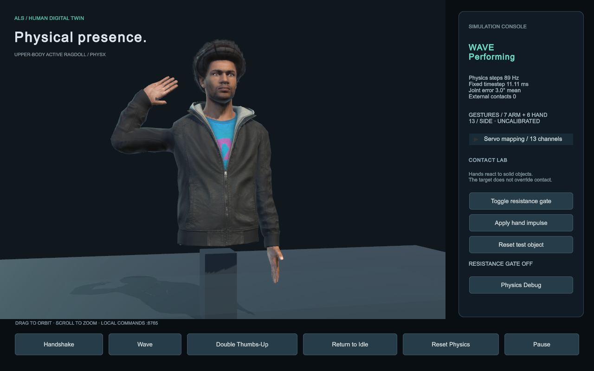

# ALS HDT 物理驱动上半身数字人

本项目是一个本地运行的 Unity 6 研究原型：用真人风格角色呈现上半身，用 PhysX 关节电机驱动双臂和手指，并提供与“7 路手臂 + 6 路手掌”设备对接的逻辑输入接口。

**当前交付：可运行的物理仿真与 13 路映射模板。实物舵机编号、运动方向及零位尚未标定，不包含实物控制驱动。**

## 从这里开始

| 你的目的 | 对应入口 |
|---|---|
| 直接打开应用、试三个动作 | [快速使用指南](Documentation/GETTING_STARTED.md) |
| 看机械手如何对应虚拟人 | [13 路硬件映射与标定](Documentation/HARDWARE_MAPPING.md) |
| 用 Python 或其他程序发送指令 | [本地命令接口](Documentation/COMMAND_API.md) |
| 调整质量、关节限位、刚度和力矩 | [物理架构与参数](Documentation/PHYSICS.md) |
| 查看人物模型来源和绑定方式 | [模型与授权](Documentation/REALISTIC_AVATAR.md) |
| 查看实际测试、截图及验证范围 | [测试记录](Documentation/TESTING.md) |

## 当前实现

| 模块 | 已实现内容 |
|---|---|
| 人物外观 | Microsoft Rocketbox `Male_Adult_04` 上半身；连续蒙皮、脸部、头发、服装与 2K 贴图 |
| 物理骨架 | 41 个 Rigidbody，39 个关节电机；躯干与颈固定，头部、双臂及指节动态模拟 |
| 预设动作 | 握手、挥手、双手点赞；平滑切换及回到 idle |
| 物理交互 | 重力、惯性、外力冲量、实体阻挡、移除阻挡后恢复、推动动态方块 |
| 设备映射 | 每侧 7 路手臂、6 路手掌；独立手指联动；左右侧独立配置 |
| 操作界面 | 动作按钮、13 路滑块、暂停/恢复、诊断复位、物理调试面板 |
| 外部输入 | 本机 TCP / JSON 指令；不依赖云端、摄像头、动作捕捉或 AI 模型 |

人物是写实风格的实时游戏资产；当前没有身份拟合、面部表情或软组织仿真。源资产采用 Microsoft MIT 许可，完整许可随工程和应用分发。

## 运行与交付文件

- **运行环境**：已构建应用面向 Apple Silicon macOS，ARM64 + Mono。
- **应用位置**：本工程内为 `Builds/macOS/PhysicsUpperBodyAvatar.app`；应用 ZIP 解压后位于根目录。
- **源码工程**：Unity **6000.5.7f1**，URP **17.5.0**；打开 `Assets/Scenes/UpperBodyLab.unity`。
- **离线使用**：构建好的应用无需 Unity Editor、Python 或网络。另一台电脑首次导入源码时，Package Manager 需要获取锁定依赖。

交付文件保存在 `Distribution/`：

| 文件 | 用途 |
|---|---|
| `PhysicsUpperBodyAvatar-macOS-ARM64.zip` | 应用、使用文档与测试资料 |
| `PhysicsUpperBodyAvatar-UnityProject.zip` | 完整源码、配置、源模型、文档与测试资料；不含 Library/Temp 缓存 |
| `SHA256SUMS.txt` | 两个 ZIP 的完整性校验 |
| `RELEASE_MANIFEST.json` | 打包信息、构建信息与测试报告摘要 |

当前没有已验证的 Windows、Intel Mac 或 Universal 应用。旧版调试人偶交付包保留在 `Distribution/Archive-Mannequin-v1/`。

## 13 路映射概览

一套手臂和手掌共 13 路；虚拟左右侧都支持，不要求实物必须有左右两套。

```text
手臂 7 路：肩部 3 + 肘屈伸 1 + 前臂旋转 1 + 腕部 2
手掌 6 路：食指 1 + 中指 1 + 无名指 1 + 小指 1 + 拇指 2
```

这是待确认的功能分配，尤其是手臂轴序和拇指第二路。`A1–A7`、`H1–H6` 是逻辑标签，不是控制板端口。所有端口默认未绑定。

同一根手指的一路输入生成多个指节目标，物理指节仍可因重力、限力矩和接触偏离目标。因此，**13 路输入不等于 13 个 Rigidbody，也不等于只有 13 个物理关节**。默认手腕仅使用两根指令轴，Y 轴锁定。

## 控制架构

```text
预设动作轨迹 ──→ 13 路姿态投影 ─┐
                               ├→ 目标骨架 → 关节电机 → PhysX 骨架 → 可见蒙皮
滑块 / localhost → 13 路输入限速 ─┘                       ↑
                                                    重力、惯性、接触
```

- **目标骨架**保存期望姿态，无 Renderer、Collider 或 Rigidbody。
- **物理骨架**由 Rigidbody、Collider、ConfigurableJoint 构成；通过有限力矩的角驱动或 PD 控制追踪目标。
- **可见蒙皮**的骨骼直接引用物理骨架，不由 Animator 或逐帧 Transform 覆盖。
- 普通动作不传送刚体；只有明确的 **Reset Physics** 诊断操作会写入复位位姿。

肘部使用有限、等大反向的 PD 力矩对；其余主要关节使用 PhysX angular drives。数值约定和各关节参数见 [PHYSICS.md](Documentation/PHYSICS.md)。

## 开发入口

| 内容 | 文件或目录 |
|---|---|
| 场景与人物 Prefab | `Assets/Scenes/UpperBodyLab.unity`、`Assets/Prefabs/PhysicsUpperBodyAvatar.prefab` |
| 物理、动作、设备参数 | `Assets/Configuration/AvatarPhysics.asset`、`Gestures.asset`、`ServoRigLeft/Right.asset` |
| 默认人物与源资产 | `Assets/Models/RocketboxPhysicalUpperBody.asset`、`Assets/ThirdParty/MicrosoftRocketbox/` |
| 关节、电机与物理骨骼 | `Assets/Scripts/Physics/` |
| 轨迹与动作状态机 | `Assets/Scripts/Gestures/` |
| 13 路映射与标定配置 | `Assets/Scripts/Hardware/` |
| 总控制、交互与 TCP | `Assets/Scripts/Controllers/` |
| 界面与诊断 | `Assets/Scripts/UI/`、`Assets/Scripts/Diagnostics/` |
| 场景生成、导入与验证 | `Assets/Editor/` |

C# 调用保持简单：

```csharp
avatar.PlayGesture(GestureType.Handshake);
avatar.PlayGesture(GestureType.Wave, 2.5f);
avatar.PlayGesture(GestureType.DoubleThumbsUp);
avatar.ReturnToIdle();
```

网络输入示例：

```json
{"action":"wave","duration":2.5}
{"action":"servo_state","side":"right"}
```

完整字段、13 路顺序、响应含义与 Python 示例统一放在 [COMMAND_API.md](Documentation/COMMAND_API.md)。

### 重建与测试

关闭打开本工程的 Unity Editor，在工程根目录执行：

```bash
Tools/unity_task.sh all       # 重建专用演示场景、物理回归、构建 macOS 应用
Tools/runtime_test.sh         # 有窗口独立应用验证，结束后自动退出
# 正常启动应用后另行执行，不要与自测实例同时运行：
python3 Tools/test_commands.py
python3 Tools/package_project.py
```

可用 `UNITY_EDITOR=/path/to/Unity` 指定 Editor；单独任务为 `setup`、`validate`、`build`。重建会覆盖专用演示场景和 Prefab，保留已有配置资产。修改质量、尺寸或骨架后应重建；修改电机与动作参数后至少重新进入 Play，并重新验证。

本机 macOS 构建采用已安装的 Mono 模块。使用 IL2CPP 需安装相应支持；改变架构应修改构建配置并在目标机器重新验证。

### 更换 FBX 或 GLB 角色

工程支持 Unity FBX 导入，并安装 glTFast **6.20.0**。内置 Rocketbox 已通过专用配方绑定；其他资产可使用 **ALS HDT → Bind imported FBX or GLB upper-body skin**，但需先对齐静止姿态、比例与关节中心。Humanoid 可自动填充骨骼映射，Generic 需显式映射；网格需启用 Read/Write 和标准 4 骨骼权重。独立衣服 Renderer 需分别处理。

导入工具不自动解决任意模型的重定向。实际资产需重新检查蒙皮、碰撞范围与全部动作。

## 验证结果与当前边界

现有报告包含 **26 项 Editor 物理检查、29 项独立应用检查、19 项 TCP 接口检查，共 74 项通过**。具体结果、采样值和合成 UI 事件的验证范围见 [TESTING.md](Documentation/TESTING.md)。它们验证的是软件原型，不是实物标定结果。

- 实物通信、舵机端口绑定、机械连杆闭环和编码器反馈尚未接入。
- 同一只手内部碰撞经过简化；仍与外部物体发生接触，不用于精细抓握或摩擦辨识。
- 躯干与颈固定，没有下半身、自主平衡、肌肉或软组织动力学。
- 有限刚度与有限迭代产生跟踪误差；参数未按个体或 ALS 患者数据拟合。
- 长时间压力测试、目标电脑原生鼠标操作及其他平台需进一步复核。

## 授权与参考

工程代码与调试人偶采用本项目 MIT。人物资产版权归 Microsoft，采用其仓库 MIT 许可；完整许可位于 `Assets/ThirdParty/MicrosoftRocketbox/LICENSE.md`，并随应用 StreamingAssets 分发。Unity 与依赖保留各自许可。

参考架构与来源记录见 [REFERENCES.md](Documentation/REFERENCES.md)。项目不播放模型动画素材，也不依赖付费资产。


